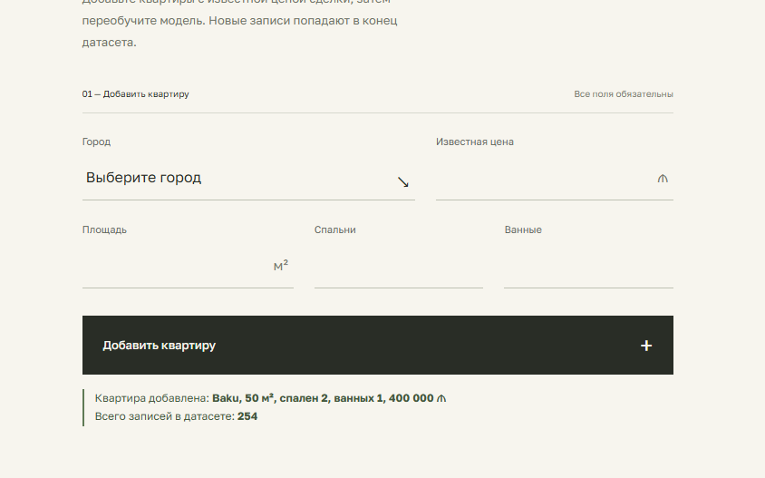
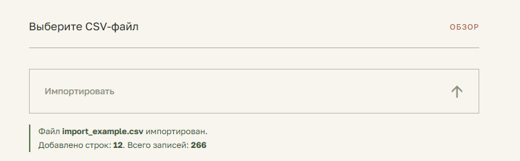
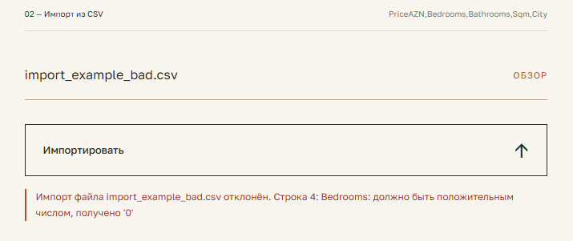
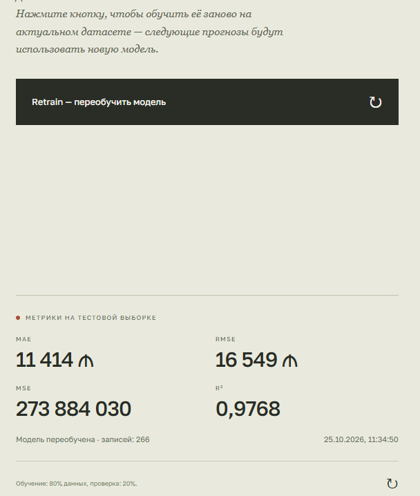

# AI 10 — Добавление данных и переобучение модели

Продолжение проекта «Прогнозирование стоимости квартир» из папки `AI 10`.
К прогнозу цены добавлена страница **«Данные»**: можно добавить одну квартиру, импортировать несколько квартир из CSV и переобучить модель кнопкой **Retrain**.

Схема осталась прежней: **React → ASP.NET Core Web API → Python FastAPI**.
React ходит только в ASP.NET, ASP.NET пересылает запросы в FastAPI, а CSV и обучение модели — на стороне Python.

## Структура

```
APIs/
  AI 10. AI Fast API/              FastAPI (порт 8000)
    main.py                        эндпоинты /predict, /apartments, /apartments/import, /retrain
    dataset.py                     проверка строк и запись в основной CSV
    training.py                    обучение pipeline (перенесено из ноутбука)
  AI 10. Price Prediction WEB API/ ASP.NET Core Web API (порт 5032)
UI/ai_10_price_prediction_site/    React + Vite (порт 5173)
data/housing_az_realistic.csv      основной датасет
data/import_example.csv            пример файла для импорта (12 записей)
data/import_example_bad.csv        пример файла с ошибкой (для проверки отклонения)
models/models_az.pkl               обученная модель
models/AI 10. Train Model.ipynb    исходный ноутбук обучения
```

## Порядок запуска

Запускать в таком порядке — каждая часть зависит от предыдущей.

### 1. FastAPI (Python 3.12+)

```bash
cd "APIs/AI 10. AI Fast API"
pip install -r ../../requirements.txt
uvicorn main:app --port 8000
```

Документация: http://localhost:8000/docs

### 2. ASP.NET Core Web API (.NET 9)

```bash
cd "APIs/AI 10. Price Prediction WEB API/AI 10. Price Prediction WEB API"
dotnet run --launch-profile http
```

API слушает http://localhost:5032, Swagger: http://localhost:5032/swagger.
Адрес FastAPI можно поменять через настройку `AI_BASE` (по умолчанию `http://localhost:8000`).

### 3. React

```bash
cd UI/ai_10_price_prediction_site
npm install
npm run dev
```

Сайт: http://localhost:5173 — вкладки «Прогноз» и «Данные» в шапке.

## Новые endpoint'ы

| Действие | ASP.NET Core Web API | FastAPI | Тело запроса |
|---|---|---|---|
| Добавить квартиру | `POST /api/AI/apartments` | `POST /apartments` | JSON |
| Импортировать CSV | `POST /api/AI/apartments/import` | `POST /apartments/import` | `multipart/form-data`, поле `file` |
| Переобучить модель | `POST /api/AI/retrain` | `POST /retrain` | — |

**Добавление квартиры** — запрос:

```json
{ "bedrooms": 3, "bathrooms": 2, "sqm": 110, "city": "Baku", "priceAZN": 250000 }
```

ответ (то же для импорта, там `added` — сколько строк добавлено):

```json
{ "message": "Квартира добавлена", "added": 1, "totalRecords": 241 }
```

**Переобучение** — ответ:

```json
{
  "message": "Модель переобучена",
  "recordsUsed": 253,
  "metrics": { "mae": 10669.4, "mse": 195129830.1, "rmse": 13968.9, "r2": 0.9808 },
  "finishedAt": "2026-10-25T07:03:34.512345+00:00"
}
```

Ошибки возвращаются в виде `{"detail": "..."}`, например:
`400 — {"detail": "Строка 4: Bedrooms: должно быть положительным числом, получено '0'"}`.
Если FastAPI не запущен, ASP.NET отвечает `503`, при тайм-ауте — `504`.
Повторный Retrain во время обучения — `409`.

## Правила проверки данных

Одинаковые для формы и для каждой строки CSV, проверяются на сервере (FastAPI) независимо от React:

- `Bedrooms`, `Bathrooms` — положительные целые числа;
- `Sqm`, `PriceAZN` — положительные числа;
- `City` — не пустой.

`PriceAZN` — это известная цена, которую вводит пользователь, а не прогноз модели.

При импорте:
- в файле должны быть столбцы `PriceAZN,Bedrooms,Bathrooms,Sqm,City` (порядок не важен, лишние столбцы — например, индекс — игнорируются);
- если хотя бы одна строка некорректна, импорт отклоняется целиком с номером строки и причиной, основной CSV не меняется;
- строки дописываются в конец `data/housing_az_realistic.csv` в порядке столбцов датасета, без повторного заголовка и без индекса.

## Пример CSV для импорта

```csv
PriceAZN,Bedrooms,Bathrooms,Sqm,City
250000,3,2,110,Baku
145000,2,1,85,Sumqayit
198000,2,1,72,Baku
312000,4,2,128,Baku
121000,2,1,78,Ganja
96000,1,1,55,Lankaran
134000,3,1,96,Mingachevir
88000,2,1,70,Shaki
176500,3,2,104,Sumqayit
109000,2,1,82,Gabala
265000,3,2,98,Baku
101000,2,1,74,Khachmaz
```

Этот же файл лежит в `data/import_example.csv`.

## Как устроено переобучение

- Логика из `AI 10. Train Model.ipynb` вынесена в `training.py`: те же признаки, `train_test_split(test_size=0.2, random_state=42)`, тот же pipeline (`SimpleImputer` + `StandardScaler` / `OneHotEncoder`) и `RandomForestRegressor(n_estimators=300)`.
- Pipeline обучается целиком на обучающей выборке, поэтому подготовка данных не «видит» тестовые строки. Метрики MAE, MSE, RMSE, R² считаются на тестовой.
- Единственное отличие от ноутбука — `OneHotEncoder(handle_unknown='ignore')`: сервер принимает любой непустой город, и без этого город, попавший только в тестовую выборку, ломал бы обучение и прогноз.
- Модель сохраняется в `models/models_az.pkl` в том же формате (`{'pipeline', 'featured_order'}`): сначала во временный файл, потом заменой — если что-то упадёт, старая модель останется. После успеха модель в памяти FastAPI заменяется, и `/predict` сразу использует новую без перезапуска.
- Добавление данных само по себе модель не меняет — только кнопка Retrain.

## Одновременные запросы

- Все записи в CSV и чтение CSV для обучения идут под одной блокировкой (`dataset.CSV_LOCK`), поэтому обучение никогда не прочитает наполовину записанный файл, а две записи не перемешаются.
- Одновременно может идти только одно переобучение (`RETRAIN_LOCK`), второе получает `409`. В интерфейсе кнопка блокируется на время запроса.
- У ASP.NET два HttpClient: обычный с тайм-аутом 30 секунд и отдельный для `/retrain` с тайм-аутом 5 минут.

## Скриншоты

| | |
|---|---|
| Добавление квартиры |  |
| Импорт CSV |  |
| Отклонённый импорт |  |
| Результат переобучения |  |
